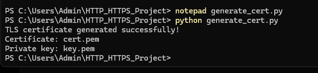
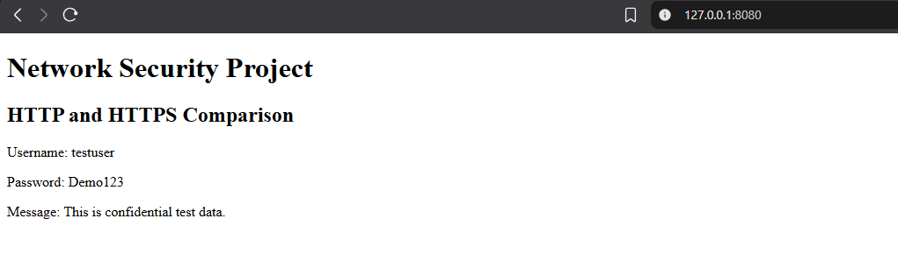
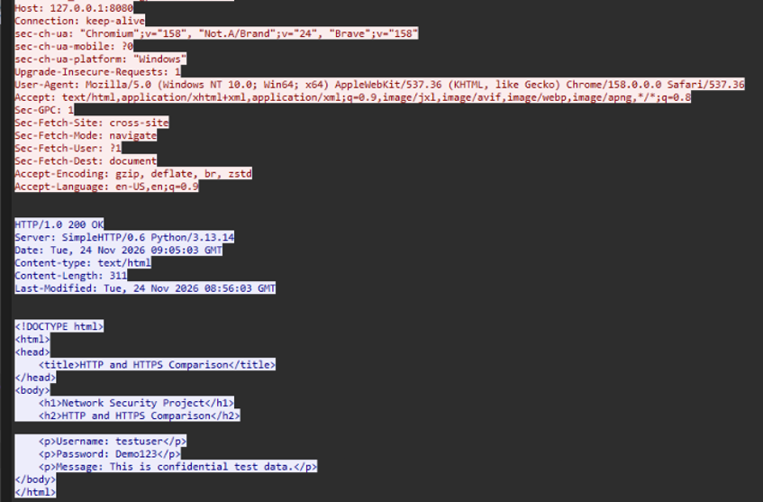
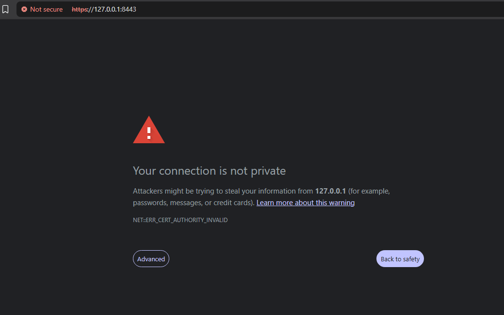
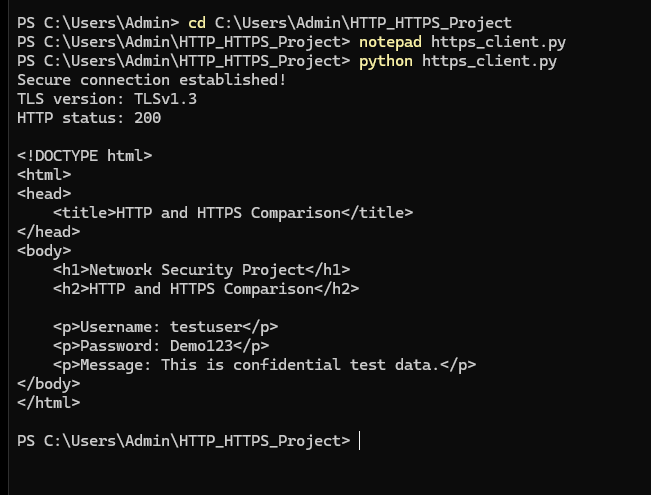
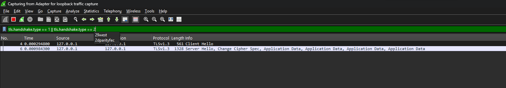
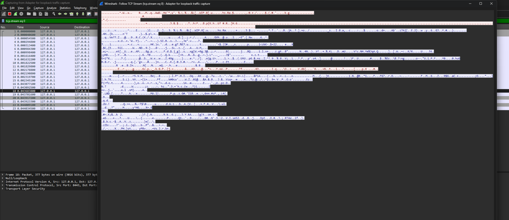

# HTTP & HTTPS Security Analysis


## Overview

A practical network security project investigating the differences between HTTP and HTTPS through local web server implementation, TLS certificate generation, certificate verification, and network traffic analysis using Wireshark.

The experiment demonstrates how unencrypted HTTP exposes transmitted information and how HTTPS protects application data using Transport Layer Security (TLS).

## Objectives

- Implement local HTTP and HTTPS web servers.
- Analyze plaintext HTTP traffic using Wireshark.
- Generate an RSA private key and a self-signed TLS certificate.
- Investigate certificate trust and verification.
- Establish a verified TLS 1.3 connection.
- Identify and analyze the TLS handshake.
- Compare encrypted and unencrypted network traffic.

## Technologies & Tools

| Technology | Purpose |
|---|---|
| Python 3.13.14 | Server and client implementation |
| Cryptography | RSA key and certificate generation |
| SSL/TLS | Secure communication |
| Wireshark | Network packet capture and analysis |
| Npcap | Loopback traffic capture |
| HTML | Local test webpage |
| PowerShell | Command-line environment |
| Brave | Browser and certificate trust testing |

## Lab Environment

| Configuration | Value |
|---|---|
| Operating system | Windows |
| Server address | 127.0.0.1 |
| HTTP port | 8080 |
| HTTPS port | 8443 |
| RSA key size | 2048 bits |
| Certificate signature | SHA-256 |
| Negotiated TLS version | TLS 1.3 |
| Certificate type | Self-signed |

## Project Structure

```text
HTTP-HTTPS-Security-Analysis/
├── captures/
│   ├── HTTP_Capture.pcapng
│   ├── HTTPS_Capture.pcapng
│   └── README.md
├── screenshots/
│   ├── certificate_generation.png
│   ├── http_plaintext.png
│   ├── http_webpage.png
│   ├── https_encrypted.png
│   ├── tls_handshake.png
│   ├── trusted_https.png
│   └── untrusted_certificate.png
├── web/
│   └── index.html
├── generate_cert.py
├── https_server.py
├── https_client.py
├── requirements.txt
├── .gitignore
└── README.md
```

## Installation & Usage

### 1. Clone the repository

```bash
git clone https://github.com/mizzsx/HTTP-HTTPS-Security-Analysis.git
cd HTTP-HTTPS-Security-Analysis
```

### 2. Install dependencies

```bash
python -m pip install -r requirements.txt
```

### 3. Generate the TLS certificate

```bash
python generate_cert.py
```

This generates a self-signed certificate and an RSA 2048-bit private key.



### 4. Start the HTTP server

Open a terminal in the project directory:

```bash
python -m http.server 8080 --bind 127.0.0.1 --directory web
```

Open the following address in a browser:

```text
http://127.0.0.1:8080
```



### 5. Start the HTTPS server

Open a second terminal:

```bash
python https_server.py
```

The HTTPS server listens on:

```text
https://127.0.0.1:8443
```

### 6. Run the trusted HTTPS client

Open a third terminal:

```bash
python https_client.py
```

The client explicitly trusts the locally generated certificate while retaining certificate and hostname verification.

## Experimental Results

### Test 1 — HTTP Plaintext Transmission

The HTTP server successfully returned the test webpage with status code 200.

Using Wireshark's Follow TCP Stream feature, the transmitted HTML content was readable, including the fictional username, password, and confidential test message.



**Observation:** HTTP does not provide encryption, allowing an observer with access to the traffic to read transmitted application data.

### Test 2 — Untrusted Certificate Rejection

Accessing the HTTPS server through Brave resulted in a certificate authority error.

```text
NET::ERR_CERT_AUTHORITY_INVALID
```



**Observation:** Encryption alone is insufficient without authentication. The browser rejected the self-signed certificate because it was not issued by a trusted authority or explicitly trusted by the browser.

### Test 3 — Verified HTTPS Connection

The Python client was configured to explicitly trust the local certificate.

The connection successfully negotiated TLS 1.3 and returned HTTP status 200.



**Observation:** Certificate verification succeeded without disabling security checks or modifying system-wide certificate trust settings.

## TLS Handshake Analysis

Wireshark identified the Client Hello and Server Hello messages during the TLS 1.3 handshake.



- **Client Hello:** Advertises supported TLS parameters and key exchange information.
- **Server Hello:** Selects TLS parameters and participates in key establishment.
- **Certificate:** Provides server authentication through certificate verification.
- **Finished:** Verifies the integrity of the handshake.
- **Application Data:** Carries protected communication after the handshake.

In TLS 1.3, most handshake messages after Server Hello are encrypted.

## HTTPS Encrypted Traffic

Following the HTTPS TCP stream reveals unreadable binary data rather than the original HTML content.



Without the appropriate TLS session keys, the captured HTTP application content cannot be read directly in Wireshark.

## HTTP vs HTTPS Comparison

| Feature | HTTP | HTTPS |
|---|---|---|
| Lab port | 8080 | 8443 |
| Encryption | No | TLS 1.3 |
| Confidentiality | No TLS protection | Protected |
| Integrity | No TLS protection | Protected |
| Server authentication | No TLS authentication | Certificate-based |
| HTML visible in capture | Yes | No |
| Sample password visible | Yes | No |
| TLS handshake | No | Yes |
| HTTP response status | 200 OK | 200 OK |

## Test Summary

| Test | Expected Result | Actual Result | Status |
|---|---|---|---|
| HTTP connection | Successful plaintext transmission | HTTP 200; readable content | Pass |
| Untrusted HTTPS | Certificate rejection | Browser certificate error | Pass |
| Trusted HTTPS | Verified encrypted connection | TLS 1.3; HTTP 200 | Pass |

## Packet Capture Analysis

The recorded Wireshark captures are available in the [captures](captures/) directory.

- [HTTP Capture](captures/HTTP_Capture.pcapng)
- [HTTPS Capture](captures/HTTPS_Capture.pcapng)

### Wireshark Display Filters

HTTP traffic:

```text
tcp.port == 8080
```

HTTPS traffic:

```text
tcp.port == 8443
```

TLS handshake:

```text
tls.handshake.type == 1 || tls.handshake.type == 2
```

## Security Considerations

- All experiments were conducted in a controlled local environment.
- All credentials and confidential messages are fictional test data.
- Certificate and hostname verification remain enabled in the trusted Python client.
- Private keys and generated certificates are excluded from version control.
- Certificates and private keys must be generated locally.
- The local servers are intended for educational purposes, not production deployment.
- Network traffic should only be captured in authorized environments.

## Skills Demonstrated

- Network security
- Packet capture and traffic analysis
- Python network programming
- TLS protocol analysis
- Public-key cryptography
- Certificate generation and verification
- Security testing
- Technical documentation

## Conclusion

The experiment demonstrates the importance of HTTPS in protecting information during network transmission.

While HTTP and HTTPS successfully deliver the same webpage, HTTP exposes application content in plaintext. HTTPS provides confidentiality and integrity through TLS, together with server authentication when certificate verification succeeds.
